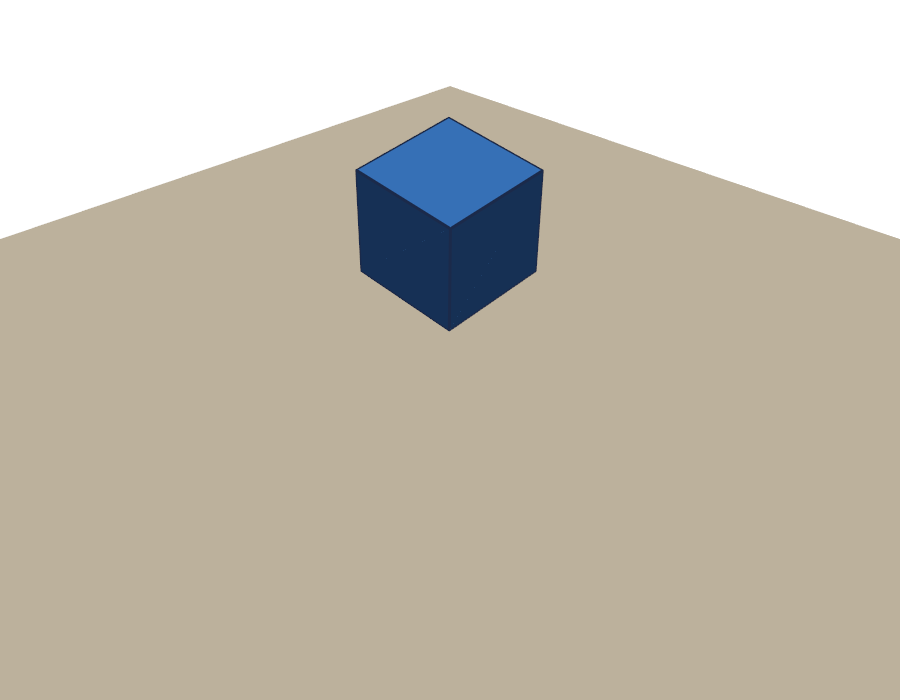

# TAC

Tac is a simple [XPBD](https://matthias-research.github.io/pages/publications/XPBD.pdf) physics engine built with [JAX](https://docs.jax.dev/en/latest/index.html).

  

A rigid box (8 points held together by pairwise length constraints) dropped onto a hard
floor with friction — see [`examples/box.py`](examples/box.py).
