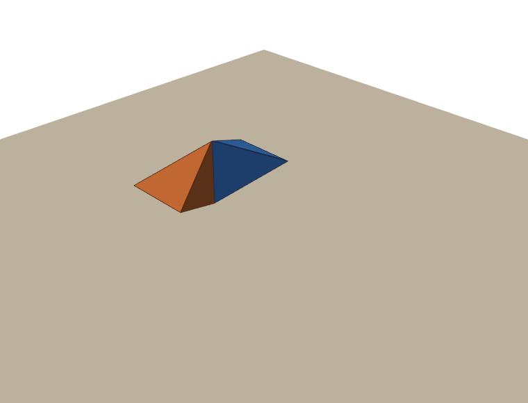
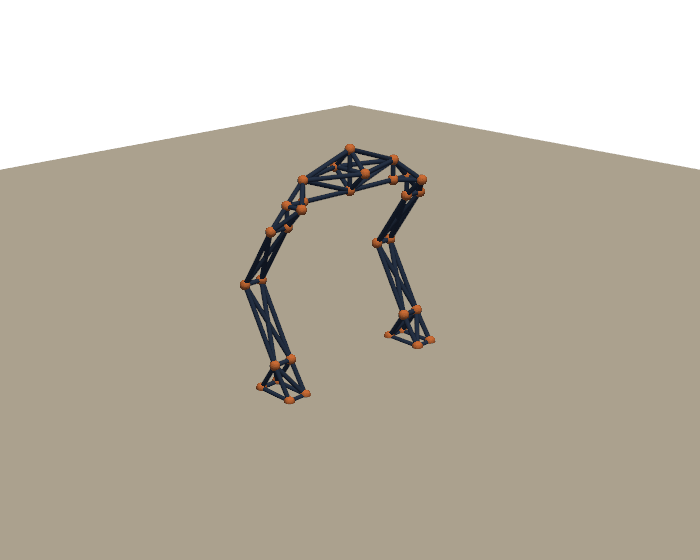

# TAC

Tac is a simple [XPBD](https://matthias-research.github.io/pages/publications/XPBD.pdf) physics engine built with [JAX](https://docs.jax.dev/en/latest/index.html).

  

A rigid box (8 points held together by pairwise length constraints) dropped onto a hard
floor with friction — see [`examples/box.py`](examples/box.py).

  

Two rigid bodies sharing a revolute hinge, driven back and forth by an actuated joint
constraint (`control = sin(t)`) — see [`examples/joint.py`](examples/joint.py).

  

"gnoci", the bipedal robot this engine is being built to estimate — a skeleton of points
wired by length, joint, and planar constraints, here taking random actions and toppling
over — see [`examples/gnoci.py`](examples/gnoci.py).
